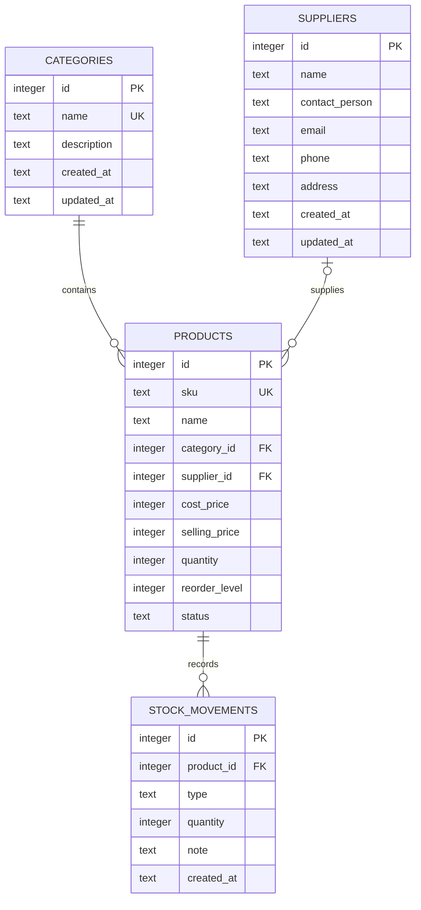

# StockPilot Database

## Overview

StockPilot uses SQLite through Node.js's built-in `node:sqlite` driver. The default persistent file is `server/data/stockpilot.sqlite`; `DB_PATH` can select another file. Every connection enables foreign keys, WAL journaling, and a five-second busy timeout. Prices use integer Sri Lankan rupee cents, so valuation never relies on floating-point arithmetic.

## Entity relationships

## Tables and integrity

- `categories`: unique case-insensitive name, optional description, and timestamps.
- `suppliers`: required name plus optional, length-limited business contact fields.
- `products`: unique case-insensitive SKU; required category; optional supplier; integer-cent prices; current quantity; reorder level; `ACTIVE` or `INACTIVE` status.
- `stock_movements`: append-only public history containing a product, `IN` or `OUT` type, positive integer quantity, note, and server-generated timestamp.

Foreign keys use `ON DELETE RESTRICT`, protecting referenced categories, suppliers, products, and movement history. `CHECK` constraints enforce nonnegative integer prices and balances, nonnegative integer reorder levels, positive integer movement amounts, and allowlisted statuses/types. Indexes cover product name, status and foreign keys plus movement history by product and time.

## Quantity and transactions

Product creation accepts an opening quantity. When it is greater than zero, the product and an `IN` movement with note `Opening stock` are inserted in one `BEGIN IMMEDIATE` transaction. A zero opening balance needs no movement because no inventory changed.

After creation, ordinary product updates cannot include `quantity`. All balance changes use the movement endpoint. It starts an immediate transaction, atomically updates the balance only when the result remains nonnegative, inserts history, and commits. Any failure rolls both operations back. SQLite's write lock plus the guarded update prevents concurrent overselling. Products with history cannot be deleted; they should be made inactive.

## Initialization and seed data

Run `npm run db:init` to apply idempotent `CREATE TABLE IF NOT EXISTS` and index statements. Existing rows are not deleted or replaced. Run `npm run db:seed` separately for realistic demonstration records. Seed inserts use stable natural identifiers and `INSERT OR IGNORE` or existence checks, so repeated execution does not duplicate data.

Tests create isolated database files under the operating system temporary directory and remove them afterward.

## Safe queries

Repositories bind every user-controlled value with `?` parameters. Search wildcard characters are escaped. Sort columns cannot be parameters, so the product repository maps the four accepted public sort names to fixed SQL expressions before building `ORDER BY`. Unchecked client strings never become SQL identifiers.
